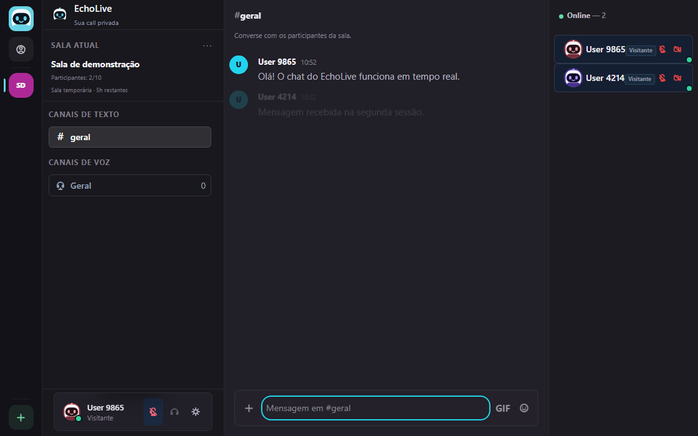

# EchoLive

EchoLive é um aplicativo web para salas privadas de voz, vídeo, compartilhamento de tela e conversa temporária em `# geral`.

[](https://github.com/brunoo-code/EchoLive/actions/workflows/ci.yml)

## Demo

[](docs/demo.webm)

[Assistir à gravação](docs/demo.webm) · [Ver o diagrama da arquitetura](docs/arquitetura.md)

A gravação usa duas sessões locais de navegador e dispositivos de mídia simulados. Para reproduzir a sala como visitante, execute `npm ci` e `npm run dev`, abra a página inicial e use o link da sala em outra sessão.

## Testes automatizados

`npm test` inicia um servidor de teste e verifica entrada em sala, rejeição de código inexistente, limite de participantes e entrega de mensagens entre clientes Socket.IO. O GitHub Actions também verifica a compilação do frontend.

## Requisitos

- Node.js LTS
- npm

## Instalacao

Na raiz do projeto:

```bash
npm install
```

Opcionalmente, crie `server/.env` a partir de `server/.env.example` para ajustar porta, origem do cliente, banco de dados, limite da sala ou servidores ICE.

## Contas e PostgreSQL

O EchoLive pode ser usado sem cadastro como visitante. Para habilitar contas persistentes, configure uma instância PostgreSQL e a variável `DATABASE_URL` no servidor. As contas usam UUID, nome de usuário exclusivo sem diferenciar maiúsculas de minúsculas, nome de exibição e senha armazenada com hash bcrypt. A sessão usa um cookie HttpOnly de 14 dias; a senha nunca vai para o navegador.

O `username` é a identidade pública única da conta. Ele aceita de 3 a 24 caracteres ASCII entre letras, números e `_`, sem espaços. O valor normalizado em lowercase é protegido por `UNIQUE` no PostgreSQL; `displayName` não possui `UNIQUE` e pode se repetir entre contas.

Com o servidor parado, aplique as migrações a partir da raiz:

```bash
cd server
npm install
npm run db:migrate
```

Sem `DATABASE_URL`, o servidor inicia normalmente, as salas temporárias continuam funcionando e as rotas de conta respondem que a autenticação está indisponível. O projeto não usa SQLite como fallback.

No Render, crie um PostgreSQL, copie a `DATABASE_URL` para as variaveis do Web Service e execute `npm run db:migrate` uma vez usando o mesmo ambiente. Depois mantenha `npm run build` como Build Command e `npm start` como Start Command.

As rotas de conta são `GET /api/auth/me`, `POST /api/auth/register`, `POST /api/auth/login`, `POST /api/auth/logout` e `PATCH /api/users/me`. Esta etapa não inclui recuperação de senha, email, amigos, mensagens diretas, servidores persistentes ou canais persistentes.

## Desenvolvimento

Para iniciar frontend e backend juntos:

```bash
npm run dev
```

Também é possível rodar separadamente:

```bash
cd server
npm install
npm run dev
```

```bash
cd client
npm install
npm run dev
```

## Acesso

- Frontend: http://localhost:5173
- Backend: http://localhost:3001
- Health check: http://localhost:3001/health

## Salas personalizadas

Na home, informe um código de 3 a 16 caracteres usando letras, números, `-` ou `_`. O código é normalizado para maiúsculas e aparece na URL, por exemplo `http://localhost:5173/room/666`. O nome visual da sala é opcional e tem limite de 32 caracteres; quando omitido, a interface usa `Sala <código>`.

O backend rejeita códigos duplicados e não cria uma sala automaticamente quando alguém tenta entrar em um código inexistente.

Exemplos neutros:

- Nome da sala: `Minha sala` | Código: `SALA01`
- Nome da sala: `Reunião` | Código: `REUNIAO`
- Nome da sala: `Estudos` | Código: `ESTUDOS`

## Teste com duas abas

1. Abra http://localhost:5173 em uma aba normal.
2. Digite um nickname e clique em `Criar sala`.
3. Copie o convite na sidebar da sala.
4. Abra uma aba anonima ou outro navegador.
5. Cole o convite.
6. Digite outro nickname.
7. Teste microfone, câmera, volume remoto, tela cheia e compartilhamento de tela.
8. Use `Alterar nick` para confirmar a atualizacao em tempo real.
9. Saia da sala e confirme que o participante desaparece da outra aba.
10. Alterne entre `# geral` e `Geral`; trocar de canal é apenas visual e não encerra a call.
11. Envie texto no chat e confirme que a outra aba recebe a mensagem.
12. Anexe uma imagem ou video aceito e confirme o preview no chat.

## Teste em outro computador na mesma rede

Em `localhost`, cada computador aponta para ele mesmo. Para testar na rede local, rode o projeto em um computador e acesse pelo IP local dele no outro:

```text
http://192.168.1.20:5173
```

O backend tambem precisa estar acessivel nessa rede. Ajuste `CLIENT_ORIGIN` no servidor e `VITE_SERVER_URL` no cliente se for usar um host diferente de `localhost`.

## Limite de participantes

O limite padrão é 10 participantes por sala:

```env
MAX_PARTICIPANTS_PER_ROOM=10
```

Esse valor fica em `server/.env`. Se a variável não existir, o backend usa 10.

EchoLive usa WebRTC em arquitetura mesh. Isso é simples e bom para poucas pessoas, mas o custo cresce conforme mais participantes entram, porque cada navegador conversa diretamente com os outros. Para salas muito grandes no futuro, o ideal seria uma SFU. Esta versão não implementa SFU.

## WebRTC

- Signaling: Socket.IO coordena entrada, saída, offers, answers e ICE candidates.
- STUN: ajuda os navegadores a descobrirem enderecos publicos.
- TURN: retransmite mídia quando conexão direta não funciona.
- ICE: escolhe o melhor caminho de conexão entre os participantes.

Socket.IO não transporta áudio, vídeo ou tela. A mídia passa por WebRTC.

## Internet, TURN e HTTPS

STUN sozinho não garante conexão confiável pela internet. Algumas redes, NATs e firewalls exigem TURN.

Configure TURN em `server/.env`:

```env
TURN_URL=turn:seu-servidor-turn:3478
TURN_USERNAME=
TURN_CREDENTIAL=
```

Não coloque credenciais reais no código.

Fora de `localhost`, `getUserMedia` e `getDisplayMedia` normalmente exigem HTTPS. Uma implantacao publica deve usar HTTPS.

## Supressao de ruido

O áudio usa recursos nativos do navegador quando disponíveis:

- `echoCancellation`
- `noiseSuppression`
- `autoGainControl`

Se algum navegador não suportar uma constraint, a captura deve continuar funcionando com o melhor suporte disponível.

Essa redução usa recursos nativos do navegador e pode reduzir ruído de teclado, ventilador e ambiente, mas não é uma solução avançada como Krisp ou Discord. Mutar/desmutar apenas alterna `enabled` na track local e não recria a captura de áudio.

## Voz e dispositivos

- A presenca online e a presenca na voz sao listas separadas por sala.
- `Sair voz` encerra apenas a mídia e as conexões WebRTC; o usuário continua online e pode usar o chat.
- `Entrar voz` recria a captura e reconecta a voz sem duplicar o participante.
- O indicador de fala usa um analisador local do navegador e transmite somente um estado booleano.
- Microfone, saída de áudio e câmera podem ser escolhidos no menu de dispositivos; as preferências ficam em `localStorage`. A saída usa `setSinkId` quando o navegador oferece suporte e cai no dispositivo padrão caso contrário.
- O avatar local aceita PNG, JPG ou WEBP de ate 1 MB e tambem fica somente no navegador.

## Chat e uploads temporarios

- Salas Rapidas permanecem reentraveis por 5 horas; depois desse prazo o backend expira a sala e novos acessos sao recusados.
- `# geral` é o canal de texto padrão da sala.
- Mensagens sao transmitidas por Socket.IO e ficam somente em memoria.
- Cada sala mantem no maximo 200 mensagens; ao ficar vazia, o historico e apagado.
- O chat aceita texto de ate 4.000 caracteres.
- Imagens aceitas: PNG, JPEG, WebP e GIF.
- Videos aceitos: MP4, WebM e MOV/QuickTime.
- Limites por tipo: imagens ate 15 MB, videos ate 50 MB e outros arquivos ate 25 MB.
- Uploads ficam em `UPLOAD_DIR` quando essa variável está configurada; sem ela, o servidor usa `server/uploads`. Os arquivos são servidos por `/uploads/...`.
- O backend gera nomes aleatorios; o nome original e usado apenas para exibicao.
- Uploads de Sala Rápida continuam temporários. Anexos de servidores e DMs só sobrevivem a reinícios em produção quando `UPLOAD_DIR` aponta para um disco persistente.

## Paridade visual e feedback local

- As superfícies autenticadas usam uma camada de apresentação diretamente derivada das estruturas públicas do Fluxer, com avisos SPDX/AGPL nos arquivos derivados. Dados, handlers, autenticação, API, banco, Socket.IO e WebRTC continuam sendo do EchoLive.
- A tipografia segue a pilha do Fluxer (`Fluxer Sans`, variantes de idioma e fallbacks `system-ui`/`Segoe UI`). Nenhum binário de fonte foi adicionado ao repositório; quando `Fluxer Sans` não estiver disponível, o navegador usa o fallback do sistema.
- A geometria canonica autenticada usa rail de `72px`, sidebar de `320px`, cabecalho de `56px`, painel de membros de `264px` e UserArea de `58px`. A Quick Room permanece isolada da camada autenticada.
- O picker de GIF usa um adapter configuravel por `VITE_GIF_PROVIDER_URL` e `VITE_GIF_PROVIDER_NAME`. O endpoint recebe `q` e `limit`, e pode responder com uma lista ou com `results`, `data` ou `gifs`. Sem URL configurada, a interface mostra o estado de provider ausente; loading, erro, vazio, recentes e selecao continuam funcionais localmente.
- A selecao de GIF insere a URL no rascunho atual. Persistencia/renderizacao duravel exige ampliar o contrato de anexos do backend e permitir o provider escolhido; isso permanece explicitamente pendente, sem inventar uma integracao externa.
- Os sons seguem o mapa de eventos do Fluxer (entrada/saída de voz, participante, mensagem, DM, solicitação de amizade, notificação, câmera, tela e mute/deafen), mas continuam gerados pelo helper local `client/src/utils/uiSounds.js`. Não foram copiados arquivos de áudio externos: o contexto Web Audio de UI é exclusivo, respeita `echolive.uiSounds`/Não perturbe e nunca entra no WebRTC.

## Scripts

```bash
npm run dev
npm run build
npm start
```

## Deploy em um único serviço

O backend Express serve `client/dist` quando essa pasta existe. Assim, o mesmo Web Service hospeda o frontend, a API, os uploads e o Socket.IO. Em desenvolvimento, o Vite continua em `5173` e o servidor em `3001`.

Configuração para Render Web Service com a raiz do repositório:

```text
Root Directory: (vazio)
Build Command: npm run build
Start Command: npm start
Environment Variables: `UPLOAD_DIR` é opcional; em produção, aponte para o ponto de montagem de um disco persistente
```

O servidor usa `process.env.PORT` e escuta em `0.0.0.0`. O cliente usa o backend local em `localhost:3001` durante o Vite e o próprio domínio quando publicado. Links de sala usam `window.location.origin`, portanto continuam válidos no domínio HTTPS do Render e ao atualizar `/room/<codigo>`.

No Render, monte um Persistent Disk e configure `UPLOAD_DIR` com o caminho desse disco, por exemplo `/var/data/echolive-uploads`. Sem disco persistente, o filesystem do serviço é efêmero e anexos antigos podem desaparecer em um novo deploy ou restart. Integração com object storage ainda exige as credenciais e o provedor que serão escolhidos para produção.

Para publicar no GitHub a partir da raiz:

```bash
git init
git add .
git commit -m "Prepare EchoLive for Render"
git branch -M main
git remote add origin https://github.com/SEU_USUARIO/SEU_REPOSITORIO.git
git push -u origin main
```

No Render, crie `New > Web Service`, conecte o repositório, escolha o plano Free, deixe `Root Directory` vazio e use os comandos acima. O Render fornecerá a URL HTTPS. O plano Free pode suspender o serviço quando ocioso, e o primeiro acesso depois disso pode demorar.

## Limitacoes atuais

- Salas e mensagens ficam apenas em memoria; contas e sessoes podem ser persistentes no PostgreSQL.
- Uploads usam disco local por padrão e devem ser limpos manualmente em uma rotina futura; em produção, configure `UPLOAD_DIR` em um disco persistente.
- Sem `DATABASE_URL`, o modo visitante funciona sem contas, senhas ou banco configurado.
- Nicknames podem ser repetidos; o identificador real e `socket.id`.
- Compartilhamento de tela substitui temporariamente a câmera enviada aos outros participantes.
- Áudio do compartilhamento de tela não é obrigatório nesta versão.
- WebRTC mesh e indicado para salas pequenas; para muitas pessoas, considere SFU em etapa futura.

## Proximos passos sugeridos

- Avaliar canais persistentes, amigos e mensagens diretas em uma etapa futura.
