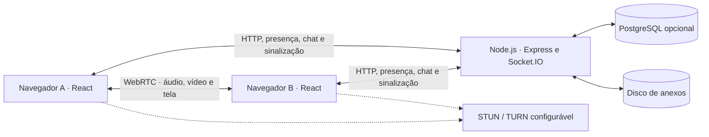

# Arquitetura do EchoLive

Ao entrar em uma sala rápida, cada navegador abre uma conexão Socket.IO com o servidor. O servidor controla a presença e distribui as mensagens do chat. Para iniciar uma chamada, os navegadores trocam ofertas, respostas e candidatos ICE pelo servidor de sinalização. Depois de negociar a conexão, enviam mídia via WebRTC, diretamente quando possível ou através de um relay TURN.

As salas rápidas mantêm participantes e mensagens em memória e funcionam como visitante sem PostgreSQL. Contas, sessões e os recursos persistentes usam PostgreSQL quando configurado. Os anexos são gravados no diretório de uploads.

## Por que usar WebRTC em malha

Em uma sala pequena, conectar cada navegador aos demais permite entregar chamadas com uma infraestrutura enxuta. Com `n` participantes em malha completa, há até `n × (n − 1) / 2` conexões e cada emissor pode enviar sua mídia para até `n − 1` destinos. À medida que a sala cresce, o custo de upload e de processamento aumenta no cliente.

Para salas maiores, uma SFU permitiria que cada navegador enviasse mídia a um servidor que encaminha os fluxos aos demais. Isso deslocaria parte do custo para a infraestrutura e exigiria mudanças na negociação e no controle dos fluxos. O EchoLive atualmente usa a malha.
